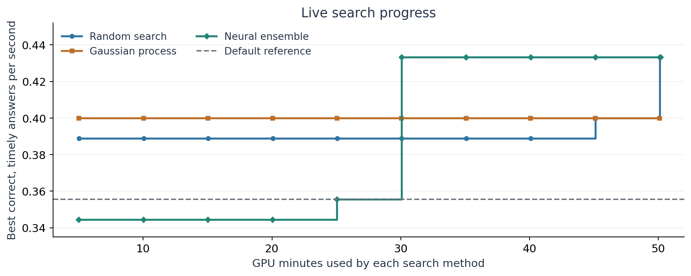
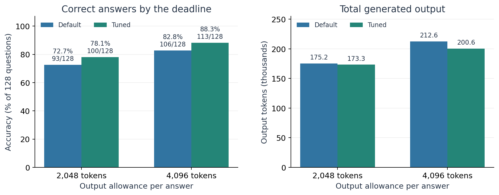

# Tuning vLLM for Small-Model Reasoning Under a Fixed GPU-Time Budget

**Experiments: 3 November 2026 | Report revised: 4 November 2026**

## Abstract

This study tested whether a small neural network could choose vLLM serving settings that produce more correct reasoning answers within a fixed compute budget. We served Qwen3-1.7B on one NVIDIA A10G GPU and compared neural-guided search with random search and Gaussian-process optimization. The default configuration provided a usable baseline of 0.356 correct, timely answers per second. Across 30 live trials, neural and random search both reached 0.433, while the Gaussian process reached 0.400. The neural result came from a common starting configuration; its four learned choices did not improve that result.

After independent validation on 150 questions, the selected settings were tested on 128 held-out questions. Each condition received the same six-minute GPU allocation. The tuned settings produced seven more correct answers than default at both output limits, but the uncertainty intervals included no difference. Raising the output limit from 2,048 to 4,096 tokens produced 13 more correct answers under both configurations. The study therefore found a benefit from allowing longer answers in this sample, but did not establish that neural tuning was better than the alternatives or uniquely enabled that benefit. Total resource use was conservatively bounded at 3.888 accelerator-hours, within the eight-hour limit.

## 1. Research question

Serving settings determine how an inference engine shares GPU capacity among requests. A setting that generates tokens quickly may still be unhelpful if answers are wrong, unfinished or too late. This study therefore asked two questions: can a learned performance model find settings that return more correct answers on time, and do the selected settings improve reasoning results when total GPU time is held fixed?

The study builds on work on serving autotuning, including SCOOT, and neural models for expensive optimization, including DNGO [1, 2]. Its focus is the combination of answer correctness, response speed and a limited experiment budget. The Qwen language-model weights remained unchanged throughout. Only the small performance model used to select serving settings was trained.

## 2. Experimental design

### Model, hardware and serving settings

All main measurements used Qwen3-1.7B in thinking mode, vLLM 0.10.2 and one NVIDIA A10G GPU [3, 4]. The model and tokenizer versions were fixed before the comparison. The following settings were shared across methods.

| Setting | Value |
| --- | --- |
| Model precision and devices | BF16; one GPU |
| Maximum context | 8,192 tokens, including input and output |
| Output limit during search | 4,096 tokens per answer |
| Sampling | Temperature 0.6; top-p 0.95; top-k 20; min-p 0; presence penalty 1.5 |
| Engine controls | Chunked prefill enabled; prefix caching disabled; GPU memory fraction 0.8 |
| Settings searched | Batched-token limit: 512, 1,024 or 2,048; concurrent-sequence limit: 8, 16, 32 or 64 |

The two searched settings form 12 possible configurations. The batched-token limit controls how many tokens the scheduler can process in a step; the sequence limit controls how many requests it can process concurrently. The default comparison let vLLM choose these two limits while retaining the same model, decoding and other engine settings. Here, "default" refers to these scheduler limits, rather than every vLLM option.

Development pilots led to the fixed presence penalty of 1.5 to reduce repetitive output. The 4,096-token limit was a study budget choice; it does not represent the model's maximum reasoning capacity. The earlier local feasibility runs were excluded from the cloud comparison and from training the performance model.

### Questions and data separation

We used GSM8K, a benchmark of grade-school mathematics questions [5]. Training questions supplied the search workload and independent validation. Official test questions were reserved for the final comparison. Expected answers were available only to the scorer and were never included in generation prompts or performance-model inputs.

| Stage | Questions and purpose |
| --- | --- |
| Baseline and live search | The same 54 scored training questions per run; two additional requests for warmup and ramp-up |
| Independent validation | 150 different training questions, used after the serving configuration was selected |
| Held-out test | The same 128 official test questions in all four conditions |
| Longer-context check | 54 other training questions with an added irrelevant prefix |

Question order and generation seeds were matched within each comparison. The test-question order was fixed with seed 724 before its contents were fetched, and generation seeds were 724-851. The selected serving configuration and the two output limits were fixed before the held-out test. These controls reduce accidental use of test results for tuning, although prior exposure to GSM8K during the language model's pretraining cannot be ruled out.

### What counts as a successful answer

The primary search measure was **quality-adjusted goodput**, abbreviated QAG: the number of correct answers that finished within the measurement window and met all response-time limits, divided by the window length in seconds. Higher values mean more useful answers delivered on time.

The response-time limits were five seconds to the first output, an average of 0.10 seconds per output token after the first, and 180 seconds from dispatch to completion. Timing was measured at the client. The per-token measure used total output tokens and elapsed time; streaming chunks do not reveal the exact timing of every token.

Scoring required a finished response with a valid final numerical answer. Truncated output, unfinished reasoning, invalid answers, timeouts and unanswered requests counted as incorrect. Accuracy used every scored question in the denominator. Answers completed after the measurement window could improve full-cohort accuracy but could not improve QAG. A candidate also had to stay within a measured accuracy drop of two percentage points from the baseline and an error rate of 1%.

During search, requests arrived at 0.6 per second over a 90-second measurement window, following five seconds each of warmup and ramp-up. A request could continue into a drain period, subject to the 120-second timeout. Arrival schedules included small fixed jitter and were matched across methods at the same trial number. The same questions were reused, so this stage measured performance on one repeated workload.

## 3. Search methods and fair comparison

Each method evaluated the same six starting configurations, followed by four choices made using its own previous results. The starting configurations were measured separately for each method and charged to that method's budget. The order of methods rotated between rounds to reduce the influence of changes over time. There were ten live trials per method and 30 in total, using one search seed.

**Random search** chose uniformly among untried configurations. **Gaussian-process optimization** fitted a conventional statistical performance model and selected configurations using expected improvement, weighted by predicted feasibility. **Neural-guided search** trained three small feed-forward networks, each with hidden layers of 64 and 32 units. Their inputs described the serving configuration and known workload; their outputs predicted QAG, 99th-percentile response time and the probability of satisfying the constraints.

The neural networks were trained by gradient descent with AdamW. Feature scaling and target normalization used only training observations. Related records were kept together when separating training and internal validation data, and early stopping selected the saved weights. Each proposal used only results already measured by that method. The actual weights, visible observations and predictions were saved before the next live trial.

The neural selection score was the predicted probability of feasibility multiplied by the sum of predicted goodput and the ensemble's standard deviation. This gives some preference to promising settings about which the networks disagree. The disagreement is a heuristic measure of uncertainty, not a calibrated confidence interval. The response-time prediction was an auxiliary training target and did not add a separate selection penalty in this experiment.

Every trial reserved approximately 300 GPU-seconds, including startup, measurement, shutdown and unused time. Each method had the same ten-trial limit and 3,175-second trial admission budget. The results below include its attributed overhead as well as its trial time; all three totals remained below that amount. Time spent fitting models while the GPU was reserved was included in resource accounting.

## 4. Baseline and live search results

The default reference completed all 54 scored questions: 45 were correct, three were truncated and no request failed at the transport level. Of the correct answers, 32 finished within the measurement window and met the response-time limits. This gave 0.356 correct, timely answers per second and an overall accuracy of 83.33%.

| Search method | Best starting QAG | Best final QAG | Improvement after starting trials | GPU minutes, including attributed overhead |
| --- | --- | --- | --- | --- |
| Random search | 0.389 | 0.433 | 0.044 | 50.11 |
| Gaussian process | 0.400 | 0.400 | 0.000 | 50.08 |
| Neural ensemble | 0.433 | 0.433 | 0.000 | 50.15 |

QAG values are correct, timely answers per second. Random search found its best result on trial 10. The Gaussian process and neural ensemble found their best results among the six starting trials. The four neural-guided choices therefore added no improvement over the neural method's starting result. All 30 trials met the measured feasibility constraints.

The final costs differed by less than five seconds. At the lowest common completed cost, about 50.08 GPU minutes, the neural history had reached 0.433 and the other methods 0.400; random search's tenth result was just beyond that point. This boundary effect, together with variation between repeated measurements of the same starting settings, makes a strong ranking inappropriate. One search per method is insufficient to establish which optimizer would perform best across repeated searches.

The selected configuration used a batched-token limit of 1,024 and a sequence limit of 32. It was chosen by the predefined rule: highest feasible measured QAG, then configuration identifier and method/run order for ties. Its winning observation was the sixth starting trial in the neural history. This is evidence about that observed configuration, rather than a configuration discovered by the learned search.

### Did the neural model predict performance well?

The four predictions below were saved before the corresponding live measurements. They provide a direct check of the model's usefulness for the choices it actually made.

| Batched-token / sequence limits | Predicted QAG | Measured QAG |
| --- | --- | --- |
| 1024 / 64 | 0.348 | 0.389 |
| 512 / 32 | 0.347 | 0.344 |
| 512 / 8 | 0.336 | 0.111 |
| 1024 / 16 | 0.229 | 0.389 |

The neural model's average absolute prediction error was 0.107 correct answers per second. Simply predicting the mean of its previous observations had a smaller error of 0.097. These four selected trials are too few to characterize general prediction accuracy, but they provide no evidence that the learned model helped this search. Each fit had only 6-9 observations and one or two internal validation groups. All observed trials were feasible, so the model was also not tested on distinguishing feasible from infeasible settings.

## 5. Independent quality validation

The selected configuration and default were then compared on 150 unused training questions with matched generation seeds. Requests were spaced at 0.6 per second for about 248 seconds within a 300-second measurement window. This differs from the search workload, so its QAG values should be compared within this table.

| Configuration | Correct answers | Accuracy | QAG, correct/s |
| --- | --- | --- | --- |
| Default | 127/150 | 84.67% | 0.423 |
| Tuned | 131/150 | 87.33% | 0.437 |

Both runs completed all 150 requests without transport errors. Tuned accuracy was 2.67 percentage points higher, with a paired 95% bootstrap interval from -1.33 to 6.67 points. The predefined empirical rule allowed the held-out test to proceed because the measured accuracy drop was within two points. However, the conservative statistical check had a lower bound of -5.09 points: it could not rule out a true drop larger than the allowed two points. Passing the practical execution rule therefore did not prove that tuning preserved accuracy. The candidate and sample size were not changed after these results.

## 6. Held-out test under equal GPU allocation

The final experiment crossed two serving configurations, default and tuned, with two output limits, 2,048 and 4,096 tokens. All four conditions used the same 128 official test questions and matched generation seeds. Each received a nominal 360-second allocation of one GPU, including startup, a 30-second teardown allowance and any unused time. Actual allocations differed by less than 0.00002 seconds.

All questions were scheduled together once the server was ready. Startup reduced the usable response deadline to approximately 291-294 seconds. This tests a finite batch of questions within a whole-device time budget. It does not measure how the service behaves under indefinitely continuing arrivals.

| Configuration | Output limit, tokens | Correct answers | Accuracy by deadline | Total output tokens |
| --- | --- | --- | --- | --- |
| Default | 2,048 | 93/128 | 72.66% | 175,235 |
| Default | 4,096 | 106/128 | 82.81% | 212,639 |
| Tuned | 2,048 | 100/128 | 78.12% | 173,274 |
| Tuned | 4,096 | 113/128 | 88.28% | 200,564 |

Every condition returned all 128 responses before its deadline, with no transport errors. Reaching the output limit still counted as a scoring failure: the default runs had 25 and 10 truncated answers at the short and long limits, while the tuned runs had 24 and 10. The seven-answer advantage for the tuned configuration therefore came from differences in answer correctness, not from completing more requests before the deadline.

| Comparison | Difference, percentage points | 95% paired interval, points |
| --- | --- | --- |
| Tuned minus default, 2,048 tokens | 5.47 | [0.00, 11.72] |
| Tuned minus default, 4,096 tokens | 5.47 | [0.00, 11.72] |
| 4,096 minus 2,048 tokens, default | 10.16 | [3.91, 16.41] |
| 4,096 minus 2,048 tokens, tuned | 10.16 | [4.69, 16.41] |
| Difference between the two allowance effects | 0.00 | [-6.25, 7.03] |

At either output limit, the tuned configuration produced seven additional correct answers, a gain of 5.47 percentage points. Both intervals include zero, so the experiment does not establish a repeatable serving-configuration advantage. Matching random seeds did not force identical generated answers across scheduling configurations; this design does not identify the cause of those differences.

Raising the output limit produced 13 additional correct answers, a gain of 10.16 points, under each configuration. The intervals for these two allowance effects were above zero. The difference between the allowance effects was zero, with a wide interval. Thus, the results support a benefit from the larger output allowance in this sample, without evidence that the tuned settings uniquely enabled it.

Intervals used 2,000 paired bootstrap resamples of questions with seed 724. Each interval describes one comparison separately. They reflect variation across the sampled questions, not variation across repeated deployments. The four conditions were run once each in a fixed order: default-short, default-long, tuned-short and tuned-long.

## 7. Additional checks and limitations

A separate longer-context check added an irrelevant prefix to 54 unused training questions and retained the frozen serving settings. Both configurations answered 48 correctly. Default QAG was 0.378 and tuned QAG was 0.411. The difference in the fraction of questions answered correctly within the window was 5.56 percentage points, with a 95% interval from -1.85 to 12.96. This small check did not establish an advantage on longer inputs.

A CPU-only replay compared neural selection with and without its uncertainty bonus. In every replay, the starting configurations already included the best entry in the recorded table. The equal final results therefore could not show whether the uncertainty bonus helps discover good settings. This replay was not an additional live GPU experiment.

The main limits are the small search space, one model, one GPU, one search per method and few observations for neural training. Reusing the profiling questions means that internal model validation did not test transfer to new question content. Selecting the highest short-run result can also favor measurement noise; independent validation helps check that result but does not remove all uncertainty.

Only 54 questions were measured per search trial, and each held-out condition was run once. These samples do not support reliable claims about rare slow responses or long-running queue stability. Fixed test order may also allow changes in hardware state or caches to affect results. The study did not evaluate quantization, multiple GPUs, separate prefill/decode servers or transfer to other hardware.

## 8. Resource use, reproducibility and conclusion

The entire task used a conservative upper bound of **3.888 accelerator-hours**, including earlier development, unsuccessful launches, setup, search, validation, idle reservations and result export. This is below the original eight-hour budget. Estimated Hugging Face charges were **US$5.6625**, below the authorized US$10. The provider confirmed cancellation but did not supply an exact finish time, so accounting extended to the recorded cancellation observation. The cost is a conservative estimate, not a verified invoice.

The accompanying project contains the exact model and dataset revisions, frozen settings, question splits, raw responses, measured timings, search histories and all four trained neural checkpoints. Its README explains how to regenerate the analysis and report. Detailed execution logs and accounting records remain available there for reproduction; they are separate from the scientific findings presented here.

This experiment established a usable baseline and completed the planned comparison within budget. It did not show that neural-guided tuning improved on the shared starting configurations or outperformed random search. The selected serving settings had higher observed held-out accuracy, but the evidence was not strong enough to establish a repeatable improvement. Allowing longer outputs improved the number of correct answers under both configurations at the same total allocation, with no observed interaction between serving configuration and output allowance.

## References

[1] Cheng et al. (2025). [SCOOT: SLO-Oriented Performance Tuning for LLM Inference Engines](https://arxiv.org/abs/2408.04323v2).

[2] Snoek et al. (2015). [Scalable Bayesian Optimization Using Deep Neural Networks](https://proceedings.mlr.press/v37/snoek15.html). ICML, PMLR 37, 2171-2180.

[3] Qwen Team. [Qwen3-1.7B model card](https://huggingface.co/Qwen/Qwen3-1.7B).

[4] vLLM Project. [vLLM 0.10.2 source](https://github.com/vllm-project/vllm/tree/v0.10.2).

[5] OpenAI. [GSM8K dataset and evaluation repository](https://github.com/openai/grade-school-math).
